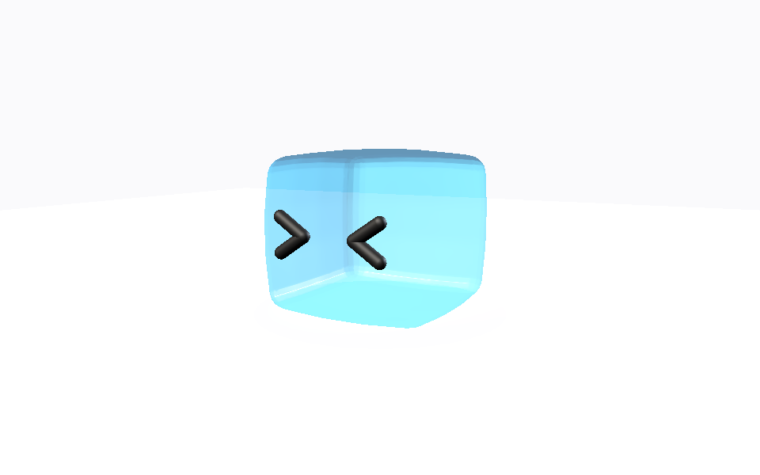
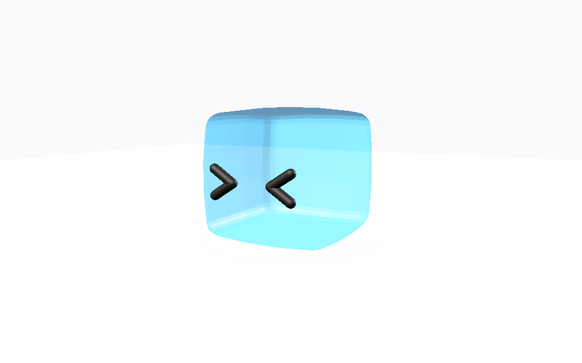

# Jelly Box · 果冻方块

一只 100% 程序化生成的果冻方块生物：Blender 脚本建模 → 导出 glTF → Godot 引擎演出。





## 特性

- **全程序化几何**：立方体细分 → 倒角 + 充气膨胀（`INFLATE` 一个参数控制鼓起程度），无手工建模
- **Shape Keys 形变**：`Stretch` 向上拉伸 / `Bend.L` `Bend.R` 左右弯曲——形变样子烘焙在资产里，引擎只驱动权重
- **实心软糖材质**：不透明鲜艳青蓝 + 清漆层湿润高光，无玻璃感
- **行为系统**：呼吸、蓄力跳跃、左右弯曲、伸懒腰 / 左右晃 / 摇摇头小剧场
- **接地影**：假 blob 阴影（半透明角色不透出真实阴影杂斑）

## 运行

需要 Godot 4.x（开发环境为 4.7）。`game/` 内已包含生成好的 `.glb`，无需 Blender 即可运行：

```bash
godot --path game
```

或用 Godot 编辑器打开 `game/project.godot`。

**操作**：`R` 切换雨天/晴天；鼠标拖动旋转视角；滚轮缩放。

## 模型源文件

`blender/jelly-box.blend` —— 在 Blender 4.x 中打开即可查看这只果冻的完整构成：倒角 + 充气变形的修改器堆栈、`Stretch` / `Bend.L` / `Bend.R` 形态键、材质节点。想改形状就调修改器参数，改完重新导出 glb 放回 `game/assets/`。

## 目录结构

```
game/                Godot 工程（可直接运行）
  assets/            jelly-box.glb + environment.tres / rain.tres（环境变体）
  scripts/           motion.gd（动作）· emotions.gd（表情）· spirit.gd（装配/决策）
blender/             jelly-box.blend 源文件
docs/                截图
```

## 架构小记

四层分离：**资产**（形变的样子）· **动作**（运动规律）· **表现**（表情）· **逻辑**（装配与决策）。改形状去 `blender/`，调手感只碰 `motion.gd`，加表情只碰 `emotions.gd`——互不干扰。

## 许可

MIT —— 见 [LICENSE](LICENSE)。
